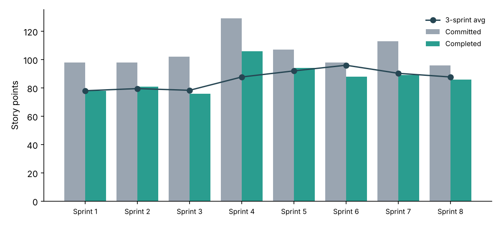
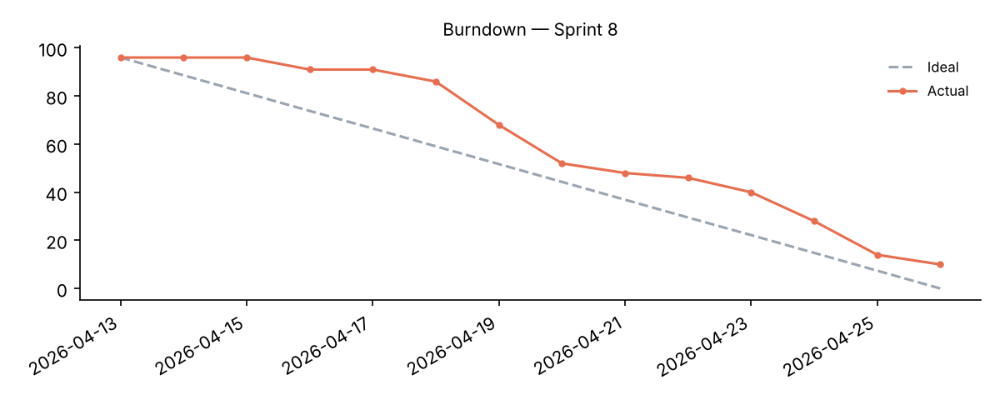

# Delivery Status Report — Sprint 8

**Overall status:** 🟢 Green

| Metric | Latest sprint |
|---|---|
| Committed / completed points | 96 / 86 |
| Say/do ratio | 90% |
| On-time completion | 80% |
| Carryover issues | 2 |
| Blocked days | 0 |

## Blocker hotspots (whole period)

| team         | assignee   |   blocked_issues |   blocked_days |
|:-------------|:-----------|-----------------:|---------------:|
| Software Dev | dev_f      |                5 |             14 |
| Software Dev | dev_c      |                5 |             13 |
| Business Dev | bd_b       |                3 |             12 |
| Business Dev | bd_c       |                4 |             11 |
| Business Dev | bd_e       |                3 |              8 |

## Before vs after process change (after Sprint 4)

- On-time rate: 57% → 82% (+43.2%)
- Blocked days per sprint: -73.3%
- Say/do ratio: 80% → 86%

## Sprint-by-sprint

| sprint   |   issues |   committed_points |   completed_points |   done_issues |   on_time_issues |   blocked_issues |   blocked_days |   say_do_ratio |   on_time_rate |   carryover_issues |
|:---------|---------:|-------------------:|-------------------:|--------------:|-----------------:|-----------------:|---------------:|---------------:|---------------:|-------------------:|
| Sprint 1 |       32 |                 98 |                 78 |            24 |               19 |               10 |             28 |          0.796 |          0.594 |                  8 |
| Sprint 2 |       29 |                 98 |                 81 |            24 |               17 |                3 |              3 |          0.827 |          0.586 |                  5 |
| Sprint 3 |       31 |                102 |                 76 |            23 |               14 |                6 |             17 |          0.745 |          0.452 |                  8 |
| Sprint 4 |       34 |                129 |                106 |            28 |               22 |                5 |             12 |          0.822 |          0.647 |                  6 |
| Sprint 5 |       32 |                107 |                 94 |            29 |               27 |                2 |              2 |          0.879 |          0.844 |                  3 |
| Sprint 6 |       32 |                 98 |                 88 |            30 |               27 |                1 |              1 |          0.898 |          0.844 |                  2 |
| Sprint 7 |       33 |                113 |                 89 |            28 |               26 |                6 |             13 |          0.788 |          0.788 |                  5 |
| Sprint 8 |       35 |                 96 |                 86 |            33 |               28 |                0 |              0 |          0.896 |          0.8   |                  2 |
